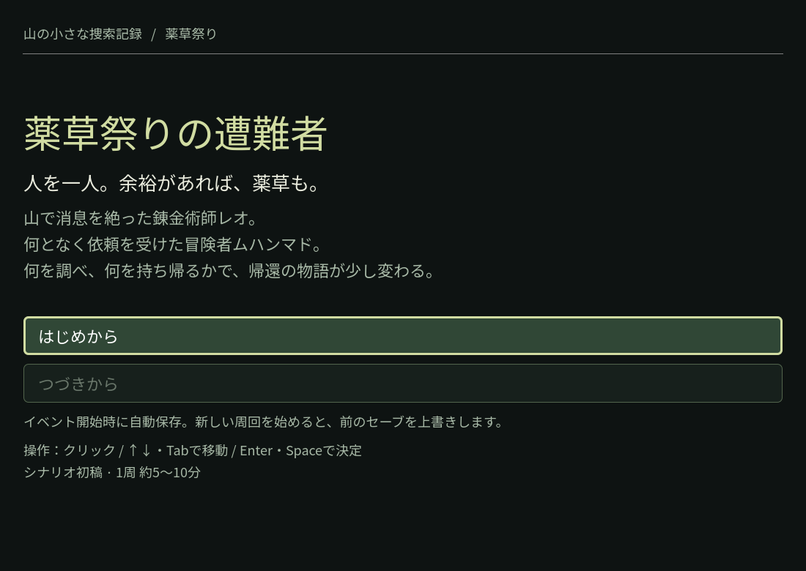
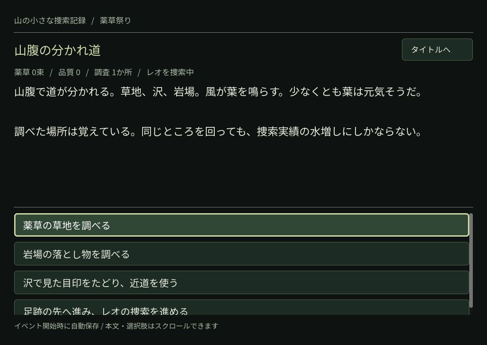

# 薬草祭りの遭難者

薬草を探すか、遭難者を探すか。行動履歴で後の会話・選択肢・結末が変わる、日本語のテキスト選択型RPGです。シナリオは作者校正前の生成初稿です。

## 起動

1. [Godot 4.7.2 stable（標準版）](https://github.com/godotengine/godot-builds/releases/tag/4.7.2-stable) を用意します。.NET版は不要です。
2. このブランチを取得し、Godotのインポートから `project.godot` を開きます。
3. 初回インポートが終わったら **F5** で起動します。プラグインは設定済みで、再ダウンロード不要です。

```bash
git clone --branch develop/yakusou-mvp https://github.com/Show-alcadeias/yakusou-maturi.git
cd yakusou-maturi
godot --headless --editor --path . --quit
godot --path .
```

Linux x86_64で実行・検証済み。Compatibilityレンダラーを使用し、ソフトウェア描画でも動作します。日本語フォントを同梱しています。

## 遊び方と保存

- クリック、↑↓またはTabで選択、EnterまたはSpaceで決定。
- 本文はイベントごとに蓄積し、本文欄と選択肢欄をそれぞれスクロールできます。
- 3か所を探索するか、途中で捜索を進めるとレオを発見します。薬草なしでも救出・帰還できます。
- イベント開始時に1枠だけ自動保存。「つづきから」はそのイベントの冒頭へ戻ります。途中で選んだ未保存の行動は巻き戻ります。
- 「はじめから」で前のセーブを上書きします。壊れたセーブは読み込まず、新規開始できます。
- Linux標準の保存先：`~/.local/share/godot/app_userdata/薬草祭りの遭難者/expedition_save.json`（`XDG_DATA_HOME` を指定した場合はその配下）。

## 使用技術

Godot **4.7.2** / GDScript / Dialogue Manager **v4.2.0**（Godot 4.6以上対応、MIT）。Noto Sans JP（SIL OFL 1.1）を同梱。追加のランタイムライブラリ、テストフレームワーク、外部メディアは不要です。固定コミット・取得元・ハッシュ・導入方法は [DEPENDENCIES](docs/DEPENDENCIES.md) を参照してください。

ゲーム固有のコード・文章への公開ライセンスは未設定です。Godot・DM・フォントのライセンスとは区別してください。再配布時には同梱・利用する各ライセンス表記を保持してください。

## テスト

Linux上でGodot、Bash、`rg`、GNU `timeout`を用意し、次を実行します。

```bash
GODOT_BIN=/path/to/Godot_v4.7.2-stable_linux.x86_64 bash tests/run.sh
```

このスクリプトは初回インポート、ヘッドレステスト、Godotの実行エラーログ検査まで行います。テスト専用の保存ファイルを使用し、終了時に削除します。

```bash
# 描画・マウス・キー入力のテスト（表示サーバーが必要）
godot --path . --script tests/gui_tests.gd
# 音声デバイスのないテスト環境では --audio-driver Dummy を追加可能
```

自動検証：**734経路完走、19,052チェック成功**。条件付き応答の真偽、全11イベント、3薬草評価、2救出速度、3救助手順、全イベント境界の保存・再開を確認。GUIは28チェック成功。詳細・制約は [TEST_RESULTS](docs/TEST_RESULTS.md) に記録しています。

## 書き出し

同じバージョンの公式エクスポートテンプレートをGodotからインストールしてください。

```bash
mkdir -p build/linux build/web
godot --headless --editor --path . --export-release Linux
godot --headless --editor --path . --export-release Web
./build/linux/yakusou.x86_64
python3 -m http.server 8765 --directory build/web
# Web版は http://localhost:8765 で開く（file://では起動しません）
```

Webはスレッド無効のプリセットです。WebGL 2対応ブラウザが必要です。ブラウザ保存領域を消すとセーブも失われます。ビルドはソース管理対象外です。

## 設計・編集の入口

- [PLAN](docs/PLAN.md)：制作前の計画と自己レビュー
- [ARCHITECTURE](docs/ARCHITECTURE.md)：責務と将来の接続点
- [SCENARIO](docs/SCENARIO.md)：11イベント・状態・分岐表
- [DECISIONS](docs/DECISIONS.md)：比較した選択肢と採用理由
- [IMPLEMENTATION_REVIEW](docs/IMPLEMENTATION_REVIEW.md)：計画と実装の比較、技術的負債
- [story.dialogue](story/story.dialogue)：本文・条件付き応答の正本



