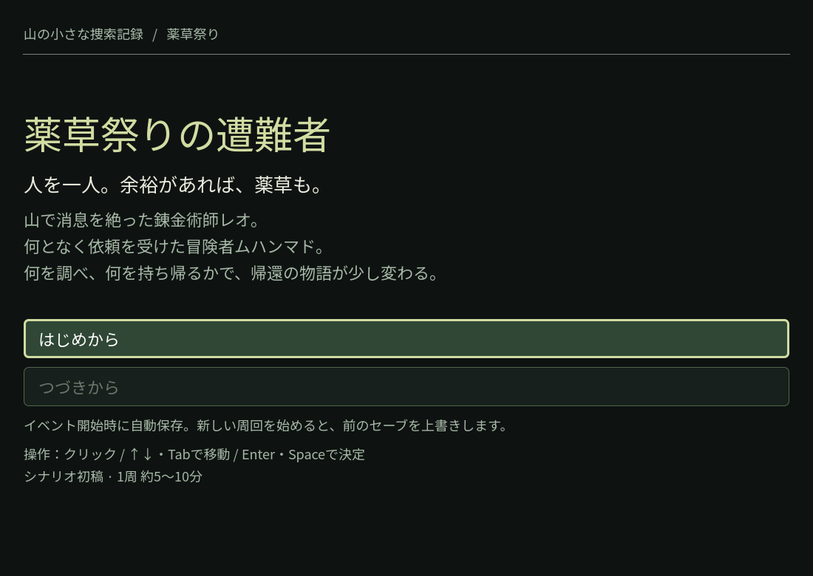
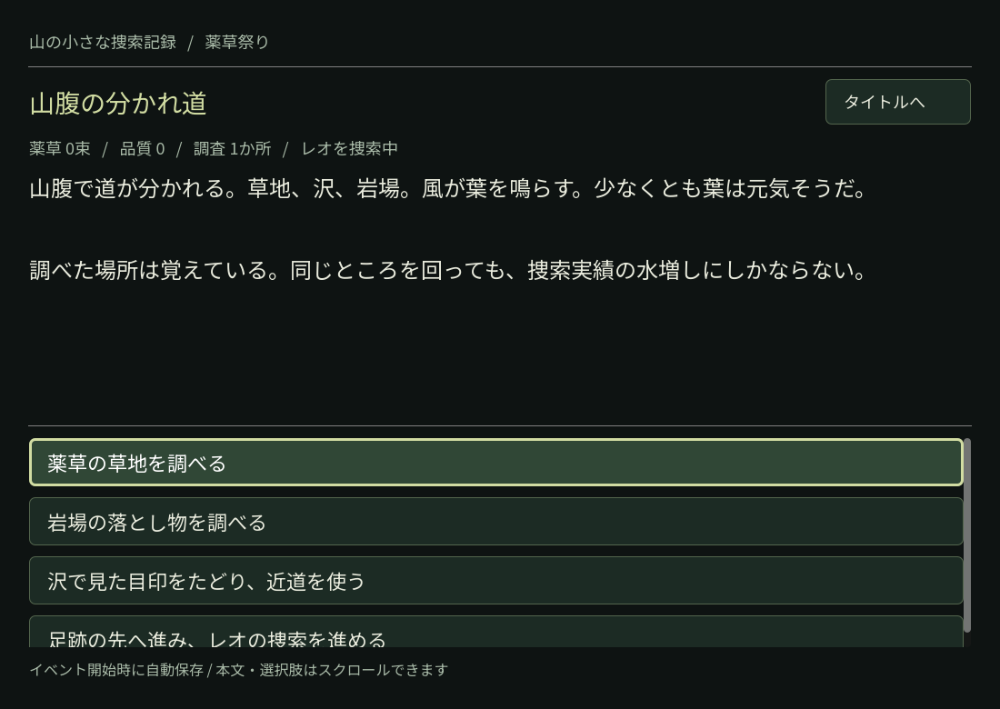
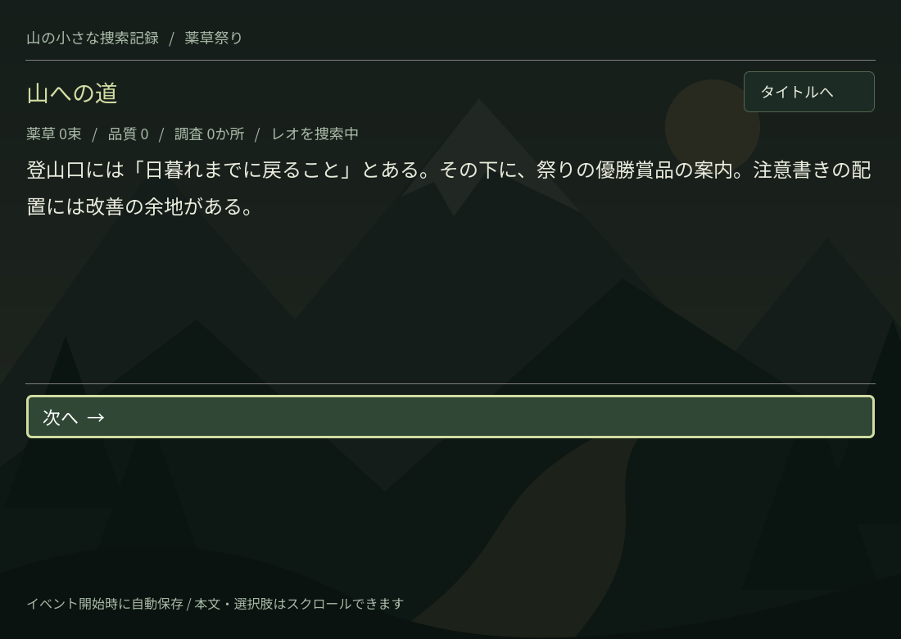
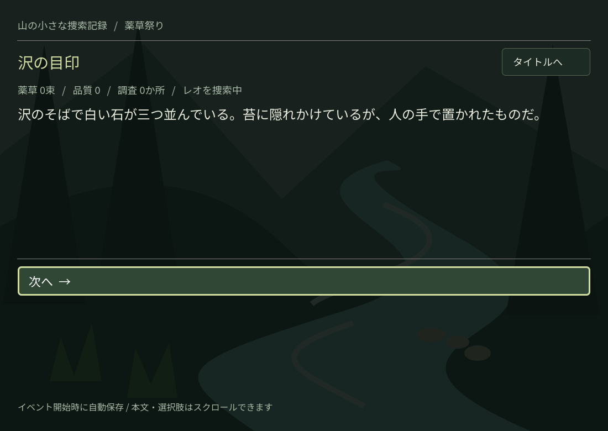

# 薬草祭りの遭難者

薬草を探すか、遭難者を探すか。行動履歴で後の会話・選択肢・結末が変わる、日本語のテキスト選択型RPGです。シナリオは作者校正前の生成初稿です。

**Ver.0.3**：全11イベントを編集診断し、履歴や評価との不整合を中心に5イベントの8段落だけ修正しました。6イベントは全文を維持し、ゲーム進行・状態管理・分岐・セーブ・Ver.0.2のメディア構成は変更していません。正式な作者校正前の稿です。

## 起動

1. [Godot 4.7.2 stable（標準版）](https://github.com/godotengine/godot-builds/releases/tag/4.7.2-stable) を用意します。.NET版は不要です。
2. 現在のmainブランチを取得し、Godotのインポートから `project.godot` を開きます。
3. 初回インポートが終わったら **F5** で起動します。プラグインは設定済みで、再ダウンロード不要です。

```bash
git clone --branch main https://github.com/Show-alcadeias/yakusou-maturi.git
cd yakusou-maturi
godot --headless --editor --path . --quit
godot --path .
```

Linux x86_64で実行・検証済み。Compatibilityレンダラーを使用し、ソフトウェア描画でも動作します。日本語フォントを同梱しています。

## 遊び方と保存

- クリック、↑↓またはTabで選択、EnterまたはSpaceで決定。
- 本文はイベントごとに蓄積し、本文欄と選択肢欄をそれぞれスクロールできます。
- 3か所を探索するか、途中で捜索を進めるとレオを発見します。薬草なしでも救出・帰還できます。
- イベント開始時に1枠だけ自動保存。「つづきから」はそのイベントの冒頭へ戻ります。途中で選んだ未保存の行動は巻き戻ります。
- 「はじめから」で前のセーブを上書きします。壊れたセーブは読み込まず、新規開始できます。
- Linux標準の保存先：`~/.local/share/godot/app_userdata/薬草祭りの遭難者/expedition_save.json`（`XDG_DATA_HOME` を指定した場合はその配下）。

## 使用技術

Godot **4.7.2** / GDScript / Dialogue Manager **v4.2.0**（Godot 4.6以上対応、MIT）。Noto Sans JP（SIL OFL 1.1）を同梱。追加のランタイムライブラリ・テストフレームワーク・生成APIは不要です。背景3枚と試験用BGM2曲は独自作成し同梱しています。固定コミット・取得元・ハッシュ・導入方法は [DEPENDENCIES](docs/DEPENDENCIES.md) を参照してください。

ゲーム固有のコード・文章への公開ライセンスは未設定です。Godot・DM・フォントのライセンスとは区別してください。再配布時には同梱・利用する各ライセンス表記を保持してください。

## メディアの差し替え・取り外し

- イベントとID、IDとファイルの対応は [media/catalog.json](media/catalog.json) に集約。素材を差し替えたらここだけ編集し、ゲームを再起動してください。空のBGM IDは停止、空の背景IDはクリアです。
- `scenes/main.tscn` のGameを選び、Inspectorの **Media Scene Path** を空にすると、文字だけで動作します。メディアシーン自体が存在しない場合も省略します。
- `scenes/media_layer.tscn` の **Audio** ノードを外すと画像だけ、**Background** を外すと音楽だけになります。どちらも外せます。
- 別実装に交換する場合、Audioという名前のノードに `request_bgm(asset_id, resource_path)`、Backgroundには `show_background(asset_id, resource_path)` を実装します。両者の継承元や相互参照は不要です。記録だけ行う代替ノードでも自動検証済みです。
- 素材の出典・音源再生成手順は [assets/media/README.md](assets/media/README.md)。音量はAudioノードの `volume_db`（初期値 −18dB）で調整できます。今回は設定画面やクロスフェードを実装していません。

タイトルは無音。山道からBGMを開始し、レオ発見時に切り替え、結末・タイトルで停止します。同じ山BGMを使うイベント間では再始動しません。セーブ再開時は既存のイベント開始通知で背景・BGMを復元します。

## テスト

Linux上でGodot、Bash、`rg`、GNU `timeout`を用意し、次を実行します。

```bash
GODOT_BIN=/path/to/Godot_v4.7.2-stable_linux.x86_64 bash tests/run.sh
```

このスクリプトは初回インポート、ヘッドレステスト、Godotの実行エラーログ検査まで行います。テスト専用の保存ファイルを使用し、終了時に削除します。

```bash
# 描画・マウス・キー入力のテスト（表示サーバーが必要）
godot --path . --script tests/gui_tests.gd
godot --path . --script tests/media_gui_tests.gd
godot --path . --script tests/editorial_gui_tests.gd
# 音声デバイスのないテスト環境では --audio-driver Dummy を追加可能
```

既存テスト：**734経路完走、19,052チェック成功**。メディアテスト：**109チェック成功、8構成でUI完走、11イベントの再開を検証**。編集比較：**8代表ルート、1,533チェック成功**。条件・応答・状態変更命令が旧稿と同じこと、同じ選択で同じ最終状態になることを検証します。

GUIは既存28＋メディア10チェックに加え、長文を読む3ルートで132チェック成功。背景の実描画とミキサーの非ゼロPCMを確認しました。Webでも背景ピクセルの変化とWebAudio出力を確認しています。実スピーカーでの聴取や文章の面白さを自動テストで証明したものではありません。最新結果は [EDITORIAL_REVIEW_V0.3](docs/EDITORIAL_REVIEW_V0.3.md) に記録しています。

編集比較は旧稿も公式DMで実行し、通常のテストでは保存済みの前後JSONを上書きしません。作業用の再実行結果は `work/editorial_after.json` に出します。読める表示文は [修正前](docs/editorial/v03/before.md)／[修正後](docs/editorial/v03/after.md)／[表示差分](docs/editorial/v03/changes.diff) を参照してください。

作者確認用のMarkdownは `python3 tools/render_editorial_snapshots.py` で保存済みJSONから再生成できます。修正前の画面を再確認する場合は `godot --path . --script tests/editorial_gui_tests.gd -- --before`。これは固定した旧稿をDMへ渡し、現行のゲーム本文を変更しません。

## 書き出し

同じバージョンの公式エクスポートテンプレートをGodotからインストールしてください。

```bash
mkdir -p build/linux build/web
godot --headless --editor --path . --export-release Linux
godot --headless --editor --path . --export-release Web
./build/linux/yakusou.x86_64
python3 -m http.server 8765 --directory build/web
# Web版は http://localhost:8765 で開く（file://では起動しません）
```

Webはスレッド無効のプリセットです。WebGL 2対応ブラウザが必要です。ブラウザ保存領域を消すとセーブも失われます。ビルドはソース管理対象外です。

## 設計・編集の入口

- [PLAN](docs/PLAN.md)：制作前の計画と自己レビュー
- [ARCHITECTURE](docs/ARCHITECTURE.md)：責務と将来の接続点
- [SCENARIO](docs/SCENARIO.md)：11イベント・状態・分岐表
- [DECISIONS](docs/DECISIONS.md)：比較した選択肢と採用理由
- [IMPLEMENTATION_REVIEW](docs/IMPLEMENTATION_REVIEW.md)：計画と実装の比較、技術的負債
- [MEDIA_EXTENSION_PLAN](docs/MEDIA_EXTENSION_PLAN.md)：Ver.0.2の実装前設計
- [MEDIA_EXTENSION_REVIEW](docs/MEDIA_EXTENSION_REVIEW.md)：後付け・交換・未接続の検証と結果
- [EDITORIAL_AUDIT_V0.3](docs/EDITORIAL_AUDIT_V0.3.md)：全11イベントの修正前診断と編集計画
- [EDITORIAL_REVIEW_V0.3](docs/EDITORIAL_REVIEW_V0.3.md)：8段落の変更前後、維持した表現、UI評価、作者確認事項
- [story.dialogue](story/story.dialogue)：本文・条件付き応答の正本





