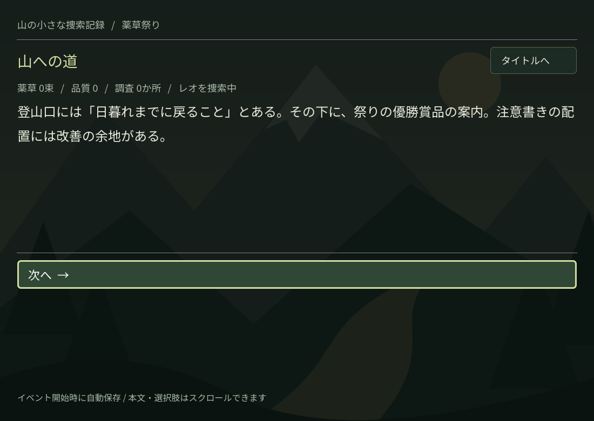
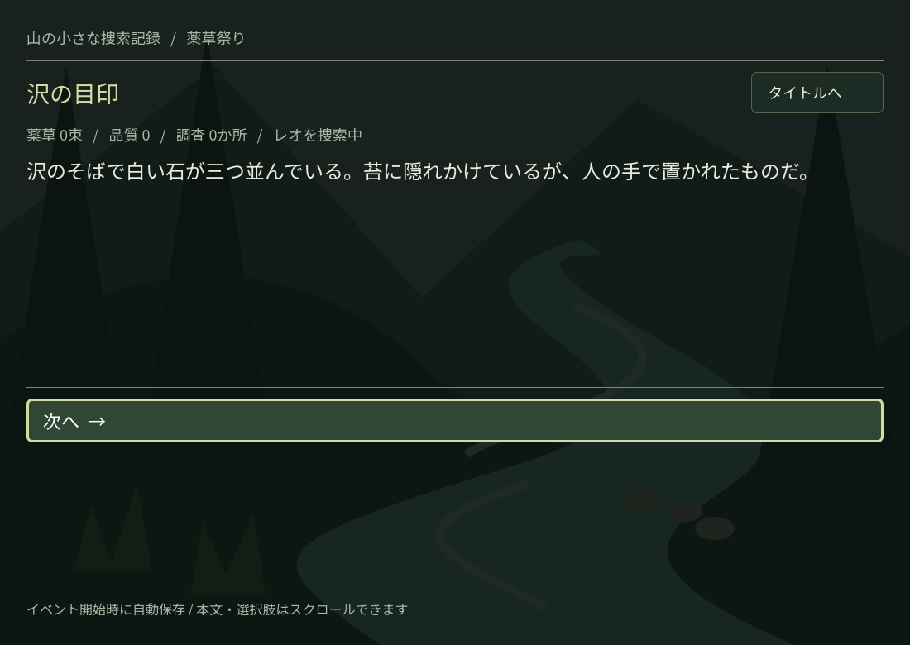

# 薬草祭りの遭難者

薬草を探すか、遭難者を探すか。行動履歴で後の会話・選択肢・結末が変わる、日本語のテキスト選択型RPGです。シナリオは作者校正前の生成初稿です。

**Ver.0.2**：既存MVPに、取り外し・交換可能な背景とBGMを追加しました。ゲーム進行・状態管理・11イベントの本文・セーブ仕様は変更していません。

## 起動

1. [Godot 4.7.2 stable（標準版）](https://github.com/godotengine/godot-builds/releases/tag/4.7.2-stable) を用意します。.NET版は不要です。
2. このブランチを取得し、Godotのインポートから `project.godot` を開きます。
3. 初回インポートが終わったら **F5** で起動します。プラグインは設定済みで、再ダウンロード不要です。

```bash
git clone --branch develop/media-v0.2 https://github.com/Show-alcadeias/yakusou-maturi.git
cd yakusou-maturi
godot --headless --editor --path . --quit
godot --path .
```

Linux x86_64で実行・検証済み。Compatibilityレンダラーを使用し、ソフトウェア描画でも動作します。日本語フォントを同梱しています。

## 遊び方と保存

- クリック、↑↓またはTabで選択、EnterまたはSpaceで決定。
- 本文はイベントごとに蓄積し、本文欄と選択肢欄をそれぞれスクロールできます。
- 3か所を探索するか、途中で捜索を進めるとレオを発見します。薬草なしでも救出・帰還できます。
- イベント開始時に1枠だけ自動保存。「つづきから」はそのイベントの冒頭へ戻ります。途中で選んだ未保存の行動は巻き戻ります。
- 「はじめから」で前のセーブを上書きします。壊れたセーブは読み込まず、新規開始できます。
- Linux標準の保存先：`~/.local/share/godot/app_userdata/薬草祭りの遭難者/expedition_save.json`（`XDG_DATA_HOME` を指定した場合はその配下）。

## 使用技術

Godot **4.7.2** / GDScript / Dialogue Manager **v4.2.0**（Godot 4.6以上対応、MIT）。Noto Sans JP（SIL OFL 1.1）を同梱。追加のランタイムライブラリ・テストフレームワーク・生成APIは不要です。背景3枚と試験用BGM2曲は独自作成し同梱しています。固定コミット・取得元・ハッシュ・導入方法は [DEPENDENCIES](docs/DEPENDENCIES.md) を参照してください。

ゲーム固有のコード・文章への公開ライセンスは未設定です。Godot・DM・フォントのライセンスとは区別してください。再配布時には同梱・利用する各ライセンス表記を保持してください。

## メディアの差し替え・取り外し

- イベントとID、IDとファイルの対応は [media/catalog.json](media/catalog.json) に集約。素材を差し替えたらここだけ編集し、ゲームを再起動してください。空のBGM IDは停止、空の背景IDはクリアです。
- `scenes/main.tscn` のGameを選び、Inspectorの **Media Scene Path** を空にすると、文字だけで動作します。メディアシーン自体が存在しない場合も省略します。
- `scenes/media_layer.tscn` の **Audio** ノードを外すと画像だけ、**Background** を外すと音楽だけになります。どちらも外せます。
- 別実装に交換する場合、Audioという名前のノードに `request_bgm(asset_id, resource_path)`、Backgroundには `show_background(asset_id, resource_path)` を実装します。両者の継承元や相互参照は不要です。記録だけ行う代替ノードでも自動検証済みです。
- 素材の出典・音源再生成手順は [assets/media/README.md](assets/media/README.md)。音量はAudioノードの `volume_db`（初期値 −18dB）で調整できます。今回は設定画面やクロスフェードを実装していません。

タイトルは無音。山道からBGMを開始し、レオ発見時に切り替え、結末・タイトルで停止します。同じ山BGMを使うイベント間では再始動しません。セーブ再開時は既存のイベント開始通知で背景・BGMを復元します。

## テスト

Linux上でGodot、Bash、`rg`、GNU `timeout`を用意し、次を実行します。

```bash
GODOT_BIN=/path/to/Godot_v4.7.2-stable_linux.x86_64 bash tests/run.sh
```

このスクリプトは初回インポート、ヘッドレステスト、Godotの実行エラーログ検査まで行います。テスト専用の保存ファイルを使用し、終了時に削除します。

```bash
# 描画・マウス・キー入力のテスト（表示サーバーが必要）
godot --path . --script tests/gui_tests.gd
godot --path . --script tests/media_gui_tests.gd
# 音声デバイスのないテスト環境では --audio-driver Dummy を追加可能
```

既存テスト：**734経路完走、19,052チェック成功**。追加メディアテスト：**109チェック成功、8構成でUI完走、11イベントの再開を検証**。メディア関連ファイルを取り除いた別コピーでも既存全経路を完走しました。

GUIは既存28＋追加10チェック成功。背景の実描画とミキサーの非ゼロPCMを確認しました。Webでも背景ピクセルの変化とWebAudio出力を確認しています。実スピーカーでの聴取は未検証です。詳しくは [MEDIA_EXTENSION_REVIEW](docs/MEDIA_EXTENSION_REVIEW.md)、MVP時点の検証記録は [TEST_RESULTS](docs/TEST_RESULTS.md) を参照してください。

## 書き出し

同じバージョンの公式エクスポートテンプレートをGodotからインストールしてください。

```bash
mkdir -p build/linux build/web
godot --headless --editor --path . --export-release Linux
godot --headless --editor --path . --export-release Web
./build/linux/yakusou.x86_64
python3 -m http.server 8765 --directory build/web
# Web版は http://localhost:8765 で開く（file://では起動しません）
```

Webはスレッド無効のプリセットです。WebGL 2対応ブラウザが必要です。ブラウザ保存領域を消すとセーブも失われます。ビルドはソース管理対象外です。

## 設計・編集の入口

- [PLAN](docs/PLAN.md)：制作前の計画と自己レビュー
- [ARCHITECTURE](docs/ARCHITECTURE.md)：責務と将来の接続点
- [SCENARIO](docs/SCENARIO.md)：11イベント・状態・分岐表
- [DECISIONS](docs/DECISIONS.md)：比較した選択肢と採用理由
- [IMPLEMENTATION_REVIEW](docs/IMPLEMENTATION_REVIEW.md)：計画と実装の比較、技術的負債
- [MEDIA_EXTENSION_PLAN](docs/MEDIA_EXTENSION_PLAN.md)：Ver.0.2の実装前設計
- [MEDIA_EXTENSION_REVIEW](docs/MEDIA_EXTENSION_REVIEW.md)：後付け・交換・未接続の検証と結果
- [story.dialogue](story/story.dialogue)：本文・条件付き応答の正本




